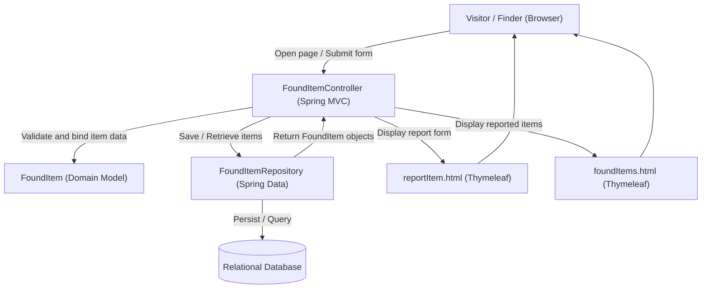

# Campus Lost & Found Board — Sprint 1 Architecture

## Overview

For Sprint 1, the application focuses on two main features: reporting a found item and browsing items that have been reported. The application uses Spring MVC, Thymeleaf, Spring Data, and a relational database.

## Architecture Diagram

## Domain Model

### FoundItem
Represents an item that someone has found on campus.

- id: Unique identifier for each item
- name: Name of the item
- description: Details about the item
- foundLocation: Where the item was found
- dateReported: Date the item was reported

### Student (Future Sprint)
Represents a student who can report or claim found items. Account creation and sign-in are outside the scope of Sprint 1, so this class is not implemented yet.

## Relationships and Design Decisions

Each found item will eventually be associated with the student who reported it. For Sprint 1, the FoundItem class stores the information needed to report and browse items without requiring a Student account.

The controller handles browser requests and passes information to the Thymeleaf templates. The repository handles saving and retrieving items from the database, keeping database operations separate from the web layer.

## Sprint 1 Workflow

1. A visitor opens the found-items page to browse reported items.
2. A finder opens the report form and enters the item's information.
3. The controller validates the submitted information.
4. If the information is valid, the repository saves the item to the database.
5. The user is redirected to the found-items page, where the new item appears.
